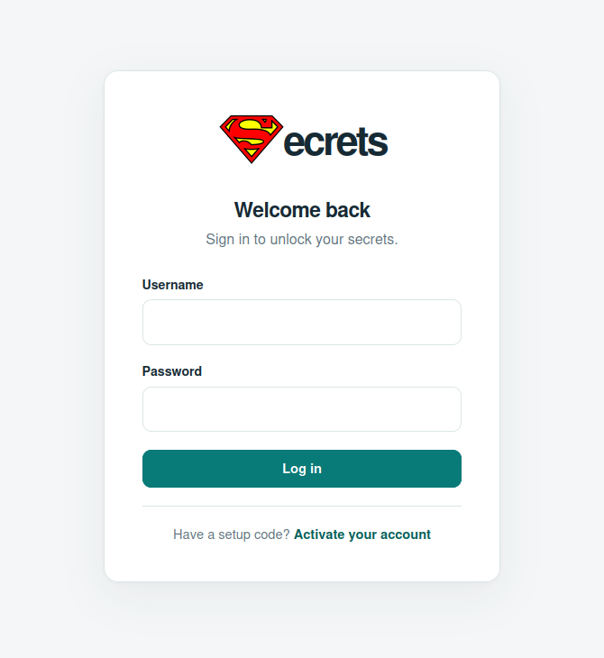

# secrets-web

Self-hosted web interface for [secrets](https://github.com/jarmo/secrets). [secrets-cli](https://github.com/jarmo/secrets-cli) is required for vault creation and user administration; users can activate accounts, manage secrets and change their passwords in the browser.



## Installation

Download a binary from [releases](https://github.com/jarmo/secrets-web/releases) and put `secrets-web` in your `PATH`. Install [secrets-cli](https://github.com/jarmo/secrets-cli#readme) on the server as well.

## Getting started

First create and activate a user using the CLI, then create a vault:

```sh
secrets user-create alice
secrets user-activate alice
secrets initialize --path /path/to/production.json --alias production --user alice
```

Start the web server with an HTTPS certificate and private key:

```sh
secrets-web serve --cert cert.crt --cert-priv-key cert.key
```

Open [https://localhost:9090](https://localhost:9090) and log in as `alice` with the password chosen during activation. Alice can now view, add, edit and delete secrets in `production`.

The server requires HTTPS, including when running behind a reverse proxy. Use a trusted certificate, such as one issued by [Let's Encrypt](https://letsencrypt.org/), for public deployments.

## Adding users and vaults

An administrator creates Bob's account with the CLI:

```sh
secrets user-create bob
```

Give Bob the one-time setup code securely. Bob opens `/activate` in the web app, enters his username and code, and chooses his own password (12–1,024 bytes). The code expires after 48 hours.

Once Bob has activated his account, grant him access from the CLI:

```sh
secrets user-add bob --alias production --user alice
```

Bob can then log in with his own username and password. To create more vaults, use `secrets initialize` and grant existing users access with `secrets user-add`.

After login, the app shows each user's accessible vaults; if there is only one, it opens directly. The **Settings** page lets users change their password for every vault they can access. No password recovery is provided.

## Configuration

By default, CLI and web use the same locations:

| Setting | Default |
| --- | --- |
| Vault aliases | `~/.config/secrets/config.json` |
| User accounts | `~/.config/secrets/users` |

Both respect `XDG_CONFIG_HOME`. Use `--config` or `--users-dir` with `secrets-web serve` to override these paths. If the server runs as a different OS user from the CLI, make sure both processes can access the intended configuration, user data and vault files, without making sensitive files publicly readable.

Use `secrets-web --help` for other options, including host, port and PID file. Check the installed version with `secrets-web --version`. Release builds use the Git tag; development builds show a commit identifier (and `-dirty` for uncommitted changes).

## Legacy vaults

During the transition, legacy vault alias/password login remains available for vaults that still have password-based access. Use the CLI to add a user to each legacy vault; this converts the vault and retires its old password. New vaults use user-based access only.

## Backups

Back up both vault files and the user directory. Losing all authorized users' passwords or identity data means permanently losing access to the vaults.

## Development

Clone and test the project; the Makefile generates web assets automatically:

```sh
git clone https://github.com/jarmo/secrets-web.git
cd secrets-web
make test
```

For an isolated development setup, create a local user and vault with the CLI:

```sh
export XDG_CONFIG_HOME="$(pwd)/tmp"
mkdir -p "$XDG_CONFIG_HOME"
secrets user-create dev
secrets user-activate dev
secrets initialize --path "$(pwd)/tmp/secrets-dev.json" --alias dev --user dev
```

Install [fswatch](https://emcrisostomo.github.io/fswatch/) for automatic restarts, then run:

```sh
make dev
```

Open [http://localhost:8080](http://localhost:8080) and log in as `dev`. This HTTP address is for local development only; use HTTPS in deployments.

Build and install:

```sh
make
make install
```

Bump `VERSION` in `secrets-web.go`, commit the change, then run `make release`. The release script creates the GitHub tag automatically and fails if the tag already exists. Set `GITHUB_RELEASE_TOKEN` to a token with repository Contents write permission.

